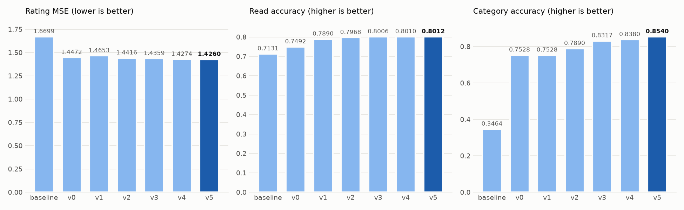

# user-behavior-modeling

Seven models (baseline, v0–v5) for three prediction tasks on Goodreads data:

| Task | Input | Output | Metric |
|---|---|---|---|
| Read | `data/pairs_Read.csv` | did the user read the book? (0/1) | accuracy |
| Rating | `data/pairs_Rating.csv` | star rating | MSE |
| Category | `data/test_Category.json.gz` | review genre (0–4) | accuracy |

## Layout

```
data/                 training data and test pairs
models/<version>/     one model file + run.py (v5 also has tune_sgd.py)
images/               result charts + plot_results.py
outputs/              benchmark.py, benchmark/ (metrics), baseline-output/, v0-output/ … v5-output/ (test predictions)
```

## Run

```
python models/<version>/run.py                    # validate, train on all data, write outputs/<version>-output/
python outputs/benchmark.py --models <versions>   # 80/10/10 benchmark -> outputs/benchmark/<version>/
```

`<version>` is one of `baseline v0 v1 v2 v3 v4 v5`; `--models` takes one or more of them.
The baseline and v0 `run.py` skip validation and only write predictions; v1–v5 also accept `--tasks`, `--tune` and `--no-write`.

Requires numpy, scipy, scikit-learn; v3–v5 also need torch and transformers (a GPU is recommended).

## Results

The test files have no labels, so every model is scored with `outputs/benchmark.py`. It splits the labelled data 80/10/10 (seed 158), tunes on the validation 10%, retrains on train + validation, and scores the held-out test 10% once.

<picture>
  <source media="(prefers-color-scheme: dark)" srcset="images/results-dark.png">
  
</picture>

| Model | Rating MSE ↓ | Read acc ↑ | Category acc ↑ |
|---|---|---|---|
| baseline | 1.6699 | 0.7131 | 0.3464 |
| v0 | 1.4472 | 0.7492 | 0.7528 |
| v1 | 1.4653 | 0.7890 | 0.7528 |
| v2 | 1.4416 | 0.7968 | 0.7890 |
| v3 | 1.4359 | 0.8006 | 0.8317 |
| v4 | 1.4274 | 0.8010 | 0.8380 |
| v5 | **1.4260** | **0.8012** | **0.8540** |

## Models

| Model | Rating | Read | Category |
|---|---|---|---|
| baseline | user's average rating (global average if unseen) | most popular books covering 50% of reads | keyword rules |
| v0 | bias model: global average + user bias + book bias | Jaccard similarity + popularity threshold | TF-IDF (1–3 grams) → logistic regression |
| v1 | latent factors trained by SGD | Bayesian personalized ranking (BPR); top half of each user's candidates | TF-IDF (1–3 grams) → logistic regression |
| v2 | tuned bias model + latent factors (ALS) | popularity + Jaccard + BPR scores combined; top half of each user's candidates | word + character TF-IDF + user's genre history → logistic regression |
| v3 | gradient-boosted trees (GBDT) stacked on v2's models | GBDT ranker over similarity and popularity features | linear model blended with fine-tuned roberta-base |
| v4 | v3 + out-of-fold stacking + zero-star features | v3 + out-of-fold stacking + EASE | roberta-base with the user's genre history as a text prefix, blended with the linear model |
| v5 | v4 + an SGD latent-factor model as a stacking feature (small K, two regularizers, early stopping, clipping) | v4 + user–user Jaccard and co-read count features | weighted ensemble: linear 0.4 + roberta-base 0.1 + roberta-large 0.5 |
